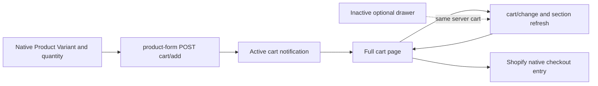

# Epic J0 — cart and checkout engineering baseline

Assessment date: **October 20, 2026**. J0 establishes the architecture, executable regression baseline and proposed backlog. **No customer-facing implementation or deployment is included.** J-PBI-001–008 remain proposals awaiting review.

Evidence root: [j0-2026-10-20T17-13-15-800Z](../qa/evidence/epic-j/j0-2026-10-20T17-13-15-800Z). The [integrated execution](../qa/evidence/epic-j/j0-2026-10-20T17-13-15-800Z/integrated-01/report.json) remains **FAIL / exit 1** because two mobile enlarged-text cases fail. J0 completion means the assessment and baseline are delivered; it does not mean the current cart meets every engineering acceptance criterion.

[Final machine-readable handoff](../qa/evidence/epic-j/j0-2026-10-20T17-13-15-800Z/j0-final-handoff-report.json) · [Concise execution and protection report](../qa/evidence/epic-j/j0-2026-10-20T17-13-15-800Z/j0-final-handoff-report.md)

## A. Executive assessment

Trade's active **cart notification plus full cart page** supports native positive-price purchases without an account requirement in the tested cart path. Single-Variant add, multiple quantities, two Saw Blade Size Variants, native prices/subtotal, quantity changes, removal, empty-cart recovery, selected-Variant URL synchronization, native 422 recovery and history navigation pass. Actual carts were isolated and cleaned. Checkout was not submitted.

Two reproducible, existing engineering defects need the proposed J1 batch:

| Defect | Severity / owner | Reproduction and deterministic result |
| --- | --- | --- |
| J-DEF-001 | High / J-PBI-001 | Reject the native Product form fetch in an offline fixture. Add controls recover, but the existing error wrapper remains hidden: no visible error announcement. `product-form.js` catches/logs the rejection without invoking its error-message handler. |
| J-DEF-002 | High / J-PBI-002 | Populate the native cart and double computed root text at 360px or 390px. Page width becomes **504px**, quantity controls reach **494px**, and item/Variant text wraps excessively. Reproduced on unchanged MAIN at 390px. Desktop passes the overflow check. |

Neither defect was introduced by J0. The inherited Epic C 558px enlarged header, Epic F EM-1 moderate heading-order issue, and Shopify preview-toolbar findings remain separately owned. Commercial launch remains blocked by the existing G006 exceptions. Shipping/payment/checkout operational readiness is not established by passing a cart test.

## B. Current architecture

The inspected repository is a substantially customized, dirty Trade workspace. Its recorded upstream baseline is Trade 15.5.0; this assessment uses the actual current files and preview, not assumptions about that upstream version. The task-start manifest records **5,756 existing files**. J0 changes only `package.json` among those existing files; all customer-facing changes are zero.



| Responsibility | Actual files and mechanism |
| --- | --- |
| Selected Variant, URL and native Product state | `assets/product-info.js`, `sections/main-product.liquid`, `snippets/buy-buttons.liquid`, ordinary and machine Product JSON templates. Saw Blade retains its four existing Size values. |
| Add to cart | `assets/product-form.js` submits native form data, selected `id` and quantity to `routes.cart_add_url`; it requests section fragments and publishes native cart events. |
| Active notification | `snippets/cart-notification.liquid`, `assets/cart-notification.js`, `assets/component-cart-notification.css`. Named dialog, Escape/close/focus return, view-cart link and native checkout form. Add responses refresh notification Product/button/header-bubble fragments. |
| Full cart | `templates/cart.json` selects `sections/main-cart-items.liquid` and `sections/main-cart-footer.liquid`; `assets/cart.js` updates quantities/removes lines and refreshes native cart/footer/bubble/live-region sections. |
| Optional drawer | `snippets/cart-drawer.liquid`, `sections/cart-drawer.liquid`, `assets/cart-drawer.js`, `assets/component-cart-drawer.css`. `CartDrawerItems` extends native `CartItems`; drawer open/close and focus trapping use native helpers. |
| Quantity, errors and events | Native `quantity-input` in `assets/global.js`, `assets/cart.js`, `assets/quantity-popover.js`, `assets/pubsub.js` and standard-event integration. Error responses preserve successful quantities and use existing live regions. |
| Notes | Native `cart-note` in `assets/cart.js` saves to `/cart/update`; markup is conditional in cart footer/drawer. |
| Checkout, discounts and express placement | Footer/notification native checkout forms submit the cart to Shopify. Footer displays native applied discounts and conditionally emits provider-supplied accelerated controls. Product dynamic checkout is disabled in both current Product templates. |

Fresh remote settings semantically equal the local settings: **cart_type = notification**, **show_cart_note = false**. The drawer is not deployed as the active cart mode. Its fixtures establish native code behavior; they do not certify a currently rendered drawer or authorize activating it. A customer-facing drawer-to-page link is therefore **NOT APPLICABLE to the active configuration**. The active notification-to-full-cart path is verified, and the native header `/cart` destination is retained.

Notification, drawer and page use the **same Shopify cookie-scoped server cart**, not independent carts. They have distinct fragment/rendering mechanisms. Notification initially renders before add and fetches the current cart for its informational view event; quantity updates and drawer/page subscribers fetch or replace their relevant sections. A cached DOM must not be treated as the source of Variant ownership or subtotal truth.

## C. Shopify capabilities and control matrix

Authenticated `shop.plan` reports **Basic**, `shopifyPlus: false`, `partnerDevelopment: false`, USD and `customerAccounts: OPTIONAL`. `checkoutApiSupported: true` is recorded but grants no entitlement. Opening plan observation was at **17:14:12 UTC**; the resumed read confirms the same plan/account state after the interruption. Exact responses are in `shop-capabilities.json` and the resume directory.

| Control boundary | What J may control | What remains outside theme authority |
| --- | --- | --- |
| Theme | Notification, drawer/page, line quantities/removal, note UI, Product links, approved explanatory messages, existing errors and native checkout entry placement | It cannot set freight/tax/payment/inventory policy by showing copy. |
| Admin / operations | Shipping profiles/rates, pickup, taxes/exemptions, payment methods, inventory/fulfillment rules, delivery promises and abandoned-checkout recovery settings | Current configuration of these services was not certified or changed in J0. K owns logistics; L owns service resources/policy. |
| Basic checkout | Standard checkout/account editor branding and eligible thank-you/order-status app surfaces are available in principle | Information/shipping/payment-step UI extensions and Checkout Branding API are Plus features. Theme Liquid/CSS/JS is not a checkout customization mechanism. |
| Conditional apps / Functions | Some eligible public app capabilities may be available | Exact API, distribution type, geography and merchant entitlement require separate verification. No app, Function, extension or proxy is authorized here. |

The Basic/Plus distinctions are documented in [Shopify's checkout editor comparison](https://help.shopify.com/en/manual/checkout-settings/customize-checkout-configurations). Extension target availability differs between checkout steps and thank-you/order-status surfaces; post-purchase access is a separate capability. [Shopify checkout technologies](https://shopify.dev/docs/apps/build/checkout/technologies) Public Function apps and custom Function apps also have different plan conditions; a custom Function app is not available merely because Basic exposes an API. [Shopify Function availability](https://shopify.dev/docs/api/functions/latest)

[Structured control matrix](../../data/epic-j-control-matrix.json) records the evidence and unverified operational settings. Checkout branding, delivery eligibility, tax exemptions, enabled wallets, payment processing and recovery settings were not exercised by submitting checkout.

## D. Native cart results

The final integrated browser execution has **eight tests: six passing, two failing**. Five offline tests execute the repository's native Liquid and JavaScript; one of those is an observation test that deliberately records J-DEF-001 as a **FAIL finding**, rather than asserting that error announcements work. The three actual preview cases use 360, 390 and 1440px. Mobile cases fail solely on the reproduced enlarged-text overflow; their other flows and cleanup continue to completion.

| Requested coverage | Evidence / result |
| --- | --- |
| Single Variant and multiple quantities | Native Saw Blade 6 inch Variant **46484258652357**, two units at $15 each in the detailed flow. PASS. |
| Two different Variants and Size selection | Native 8 inch Variant **46484258685125**, one unit at $25; selected native `id` and Variant URL update correctly. Four Size options remain. PASS. |
| Price and subtotal | Exact two-line total **5500 cents / $55.00 USD**. Quantity increase/decrease updates the same native line identities. PASS. |
| Removal and empty recovery | Native removal, server cart count zero, empty-state content visible and checkout hidden. PASS with explicit cleanup. |
| Notification/page navigation | Named active dialog, Escape/focus return and native view-cart link. PASS. Drawer is inactive; native drawer fixtures are separately labeled. |
| Availability and errors | EM-1 is natively disabled/sold out in actual preview; no purchase attempted. Offline unavailable/422 update restores quantity and announces the line error. Rejected network fetch exposes J-DEF-001. |
| Invalid live-page update | A network-intercepted 422 on actual cart HTML shows a visible error; server cart state stays unchanged. The invalid request never reaches Shopify. PASS. |
| History | Back/forward preserves native server cart state and two line identities. PASS. |
| Keyboard, labels and mobile | Dialog focus return, quantity labels, visible/enabled checkout and its native form owner pass. Mobile 200% text readability/overflow is FAIL. |
| Account and restriction boundaries | Anonymous carts work; account setting is optional. MR16 and Saw Vice are observed with enabled native Add buttons and exact IDs, without adding either. No checkout/account restriction or price threshold is introduced. |

Fixtures reuse `scripts/lib/epic-f-machine-fixtures.js` for Liquid/platform adaptation. They do not duplicate the Shopify cart backend. First attempts exposed fixture adapter/script-order issues and an over-narrow access-cookie filter; those failed runs remain in their original directories. The corrected full integrated run remains failed on the real mobile defect, not relabeled green.

## E. Machine commerce

The read-only G1/E capture reconciles **122 Products / 125 Variants**, including **111 G Products / 114 G Variants**. Roles remain 54 replacement parts, 39 consumables, 18 accessories and 11 machines. Four approved price changes and the attachment title match the exact native successor. Current native machine fields are in `machine-native-shipping-observation.json`; Admin availability is not treated as rendered purchase eligibility.

All eleven observed machine Variants have native `requiresShipping = true`. Published machine weights include BeadMaster 75 lb, EM-1 121 lb, LapMaster 12/18 180 lb each, SawMaster 18 490 lb, SawMaster 24 525 lb, ShapeMaster 120 lb and TrimMaster 90 lb. Three unpublished machines have zero recorded weight. These are **observed native fields**, not approved freight classifications, package/shipping weights or quotes. Weight alone cannot establish a shipping rate, region or delivery promise.

| Candidate | Classification / boundary |
| --- | --- |
| Mixed machine/consumable cart | Native identities/prices and common cart markup supported; an offline fixture uses exact LapMaster 18 and Saw Blade identities. No real machine add, shipping calculation or fulfillment promise is claimed. |
| Freight, oversized, destinations and shipping estimate | Native shipping/tax-at-checkout note exists. No custom calculator was found in inspected cart code. Exact profiles/rates/membership and freight policy require Admin configuration, K authority and J-DEC-001 before optional messaging. |
| Pickup, lead time, preorder and split shipment | Not verified. Require K operations/business approval and relevant Admin configuration; no inferred promise. |
| Required accessories / compatibility | Not inferred from mixed cart, names, price, native Related products or absence of a fit grant. Optional future consumer requires exact E/F authority and G003 lifecycle policy. J-PBI-007 is deferred. |
| PO, exemption, financing and quote guidance | No approved operational workflow is established by J0. J-DEC-002/004 and K/L resources are needed for selected features; no payment or tax eligibility claim. |
| Warranty / safety acknowledgement | No new mandatory acknowledgement is justified by this evidence. L and owner authority must establish any legitimate requirement first; optional/deferred. |
| Discounts / express entry / recovery | Existing applied-discount display and conditional provider container are supported by native code. Future copy/placement depends on J-DEC-004; provider eligibility and abandoned-checkout settings remain operational, unverified. |

MR16 remains native $0.00 with selling price/specification deferred. Saw Vice remains generic $0.00 with four received model prices but unresolved Product/Variant mapping. Both commercial blockers remain. Approved prices are attachment $75, Arbor Wrench $12, Automatic Feed Clamp $65.50 and LapMaster Lap Bolt $5.75; separate TrimMaster remains $1150. No hold, free-sale approval, publication action or cart-wide zero-price block is inferred.

## F. Accessibility and performance

Cart page measurements cover **360/390/1440px and 200% root text**. J0 uses root text enlargement, not a claim of browser-zoom certification. Native dialog labels/modal semantics, focus return, quantity labels, errors, subtotal and checkout visibility are assessed beyond axe/overflow alone. J-DEF-002 includes both measured geometry and actual screenshots; mobile title/Variant readability is visibly poor at enlargement. Six further inactive-drawer fixtures cover all three widths at normal/200% text: dialog semantics, trapped focus, focus return and no hidden drawer controls receiving focus after closure pass. They record outer geometry without claiming every clipped-content or wallet state is certified. No native view-cart link exists inside that drawer; activating it would require a separate reviewed navigation decision. It is not described as a live preview feature.

Actual cart axe results contain **no storefront-owned violations** in the tested cases. Serious/critical findings in the verified Shopify CDN preview-bar iframe remain recorded separately. The 558px header at enlarged text remains Epic C's inherited high-usability issue; EM-1's moderate heading-order issue remains Epic F's inherited record. J0 neither fixes nor closes either. Current cart overflow also reproduces on unchanged MAIN, so it is an existing J finding, not a new regression caused by J0.

Performance reuses `validate-brand-performance-budget.js` observers, network attribution, median function and the existing `brand-performance-budget.json` thresholds. Twelve cold **empty-cart** samples cover two widths, two themes, three samples each; no sample was discarded and there were no raw threshold outliers.

| Width/theme | LCP median | CLS median | TBT median |
| --- | ---: | ---: | ---: |
| 390 MAIN | 784ms | 0.0163883 | 0ms |
| 390 preview | 700ms | 0.0163883 | 17ms |
| 1440 MAIN | 684ms | 0.0097615 | 2ms |
| 1440 preview | 712ms | 0.0097615 | 6ms |

All measured runtime thresholds pass: LCP 2500ms, CLS 0.1, TBT 200ms. Raw samples, network summaries and maximums remain in `integrated-01/performance.json`. This is an empty-cart baseline; it does not certify populated-cart performance, all wallet states, F performance integrity or final production release gates. J0 introduces zero runtime bytes, so no new J0 customer-code performance regression is claimed.

## G. Protected state

J0 pins **730 existing cart/Product/theme/E/F/G sources** and compares all pre-existing task files. Original E/F/G receipts, grants, native successor, screenshots and other historical evidence remain unchanged. Complete MAIN **438-file** and preview **450-file** inventories match the preceding G4 closing inventories, J0 opening/closing captures and resumed readback. Roles remain MAIN and UNPUBLISHED respectively. There are no theme writes.

`theme-integrity.json` records exact returned body SHA-256 and stored MD5 values. `theme-representation-verification.json` proves exact parsed equality for preview cart/Product/machine/home JSON and settings; generated headers/formatting are not misreported as runtime changes. MAIN's existing runtime differences from local preview are recorded, not overwritten or accepted as a new production release.

Owner authority remains valid at the current J0 check, expiring **2026-10-22T20:26:37.102Z**. Current authenticated catalog evidence is timestamped October 20, 17:14:27.595Z–17:14:50.648Z. Its exact identity/class/reference/publication and native successor proofs pass. The G2 presentation lease expired at **17:06:42.312Z** earlier that day; suppressed fit is expected. No fit refresh or private approval renewal is performed. Ordinary cart/Product behavior remains independent of optional relationship presentation expiry.

G003 private revocation/production policy, G005's two overwritten historical PNG exceptions and G006 commercial decisions remain open. J0 output isolation does not recover those old bytes or close those PBIs.

## H. J0 automation

New commands extend the **existing Playwright runner**, its Chromium project, existing native Liquid fixtures, E/G Admin pagination and the existing performance functions:

```powershell
npm.cmd run validate:epic-j-j0 -- --evidence docs/qa/evidence/epic-j/<new-unique-directory>
npm.cmd run validate:epic-j-j0 -- --governance-only --evidence docs/qa/evidence/epic-j/<another-new-directory>
npm.cmd run validate:epic-j-readiness
npm.cmd run test:epic-j-readiness
npm.cmd run test:epic-j-cart
```

Individual commands require `RHINO_J_EVIDENCE_DIR`; actual cart tests additionally require `RHINO_J_LIVE=1`. The orchestrator provides these and reserves its output directory before child execution. Reuse of completed/reserved evidence is refused. Standalone browser artifact destinations must remain under the new J evidence directory. Existing E/F/G tools and prior baseline reports remain intact.

Governance covers protected hashes, native routes/controls, exact Variant/price/ownership, plan assumptions, absence of new promises, required decision records, receipt/observation expiry, remote identities/full inventories and historical/traversal output denial. The **41-case matrix has nine positive and 32 negative cases**. Fixtures reject MAIN swaps, publication/truncation/unrelated checksums, wrong Variant/Product/price, missing source, arbitrary zero-price/account restrictions, Basic checkout UI assumptions, absent decisions, expired evidence and incomplete authenticated pagination. An allowed read-only checkout preload is distinguished from a checkout submission; no paid flow is opened.

The original integrated command ran nine commands: eight exit 0; cart browser exit 1. Theme Check, repository architecture, native purchase architecture, registers, cart configuration and performance all pass. A later offline execution passes five tests while retaining the network-error **FAIL diagnostic**; six additional drawer cases pass. Their first attempt asserted closed-state tab order while the native visibility transition was still running; that failure is retained, and the corrected assertion waits for computed visibility to become hidden. The interrupted final-governance attempt remains incomplete in its original directory; resumed validation uses a new one and does not fabricate completion of that interrupted command. The resumed seven-command governance run exits 0; final source/readiness tests pass 41 cases. Exact results and source hashes are linked from the final handoff report.

## I. Proposed Epic J PBIs

| Order | PBI | Scope / dependency | Priority for review |
| --- | --- | --- | --- |
| 1 | J-PBI-001 | Native failure/retry/state reliability; depends J0 | MVP / J1 |
| 2 | J-PBI-002 | Cart-specific readability/accessibility; depends J001 | MVP / J1 |
| 3 | J-PBI-003 | Approved equipment delivery context; depends J001 + K/J-DEC-001 | Optional / J2 after authority |
| 4 | J-PBI-004 | Optional notes and purchase support; depends J001/J002 + J-DEC-002/L | Optional / J2 |
| 5 | J-PBI-005 | Explicit Product-level commercial dispositions; depends J001 + G006/J-DEC-003 | Conditional / J2 |
| 6 | J-PBI-006 | Approved discount/express entry clarity; depends J002 + J-DEC-004 | Optional / J3 |
| 7 | J-PBI-007 | Bounded relationship guidance; depends J001 + G003/J-DEC-005 | Deferred |
| 8 | J-PBI-008 | Integrated acceptance/release-boundary handoff; depends J001/J002 and only optional features actually selected | MVP / J4 |

The [tracker](../rhino-lapidary-pbi-tracker-epic-j.md) contains individual acceptance contracts. The [structured register](../project/epic-j-proposed-backlog.json) records user value, actual baseline, scope/exclusions, dependency order, tests, files, decisions, MVP status and batch for every PBI. All remain **PROPOSED_PENDING_REVIEW**, with implementation authorization false. The master Epic's idea list is not an all-features MVP requirement.

## J. Business decisions

No new commercial decision blocks J0 or proposed J1 fixes. Five conditional records apply only if their future feature is selected: logistics mapping/copy, optional notes/PO/service workflow, G006 Product-level disposition, express/discount workflow and cart relationship meaning/lifecycle. [Decision record and pencil worksheet specification](../project/epic-j-business-decisions.md) provides exact PBI ownership, required evidence and a two-page handwriting-friendly format. It does not reopen all optional ideas for immediate approval.

## K. First engineering batch

Review **J-PBI-001 and J-PBI-002** first. Proposed runtime file allowance is exactly **assets/product-form.js** and **assets/component-cart-items.css**, with existing J/native purchase tests and a properly reviewed source successor. No global header, configuration, checkout app, price, shipping policy or compatibility work is included. The [assignable J1 prompt](../project/epic-j-first-engineering-batch.md) specifies reproductions, exact files, rollback/protection expectations and regressions. It is not authorization to start that batch during J0.

## L. Shopify operation accounting

Authenticated Admin data reads: **42** across J0 and resumed readback: 26 complete catalog pages, one opening plan query, six opening theme inventory/body queries, four first closing inventories and five resumed inventory/plan queries. Schema discovery and validator calls are separate from data reads. No Admin/catalog/customer/order mutations occurred.

Across all retained J0 live test attempts, **28 actual cart POSTs** were made in eight isolated carts. All eight are finally verified empty. Three additional invalid cart updates were intercepted fixtures on actual HTML and did not reach Shopify. Offline fixture POSTs are also emulated and separate. One isolated session's cleanup initially lacked final confirmation after a transient read failure; recovery using only that run's own trace proved the cart was already empty, with **zero additional POSTs**. No existing customer cart was accessed.

**Preview writes 0; MAIN writes 0; publication 0; shipping/payment configuration changes 0; checkout submissions 0; orders 0.** No unresolved $0 Product was added. Password-unlock and passive storefront/CDN traffic are not individually counted as Admin reads or cart POSTs. Initial over-broad request guards blocked only `/checkouts/internal/preloads.js` background scripts; those raw events do not represent a user checkout attempt. The refined guard allows that exact read-only script and still rejects checkout/account/Admin operations.

The final handoff separates **J0 delivery complete**, **functional regression acceptance FAIL**, **commercial launch BLOCKED**, and **later implementation/production authorization false**. The two defects remain assigned, reproducible and unfixed for Product Owner review.
